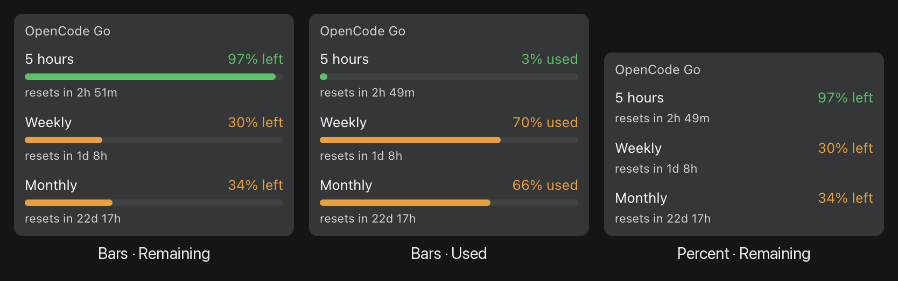
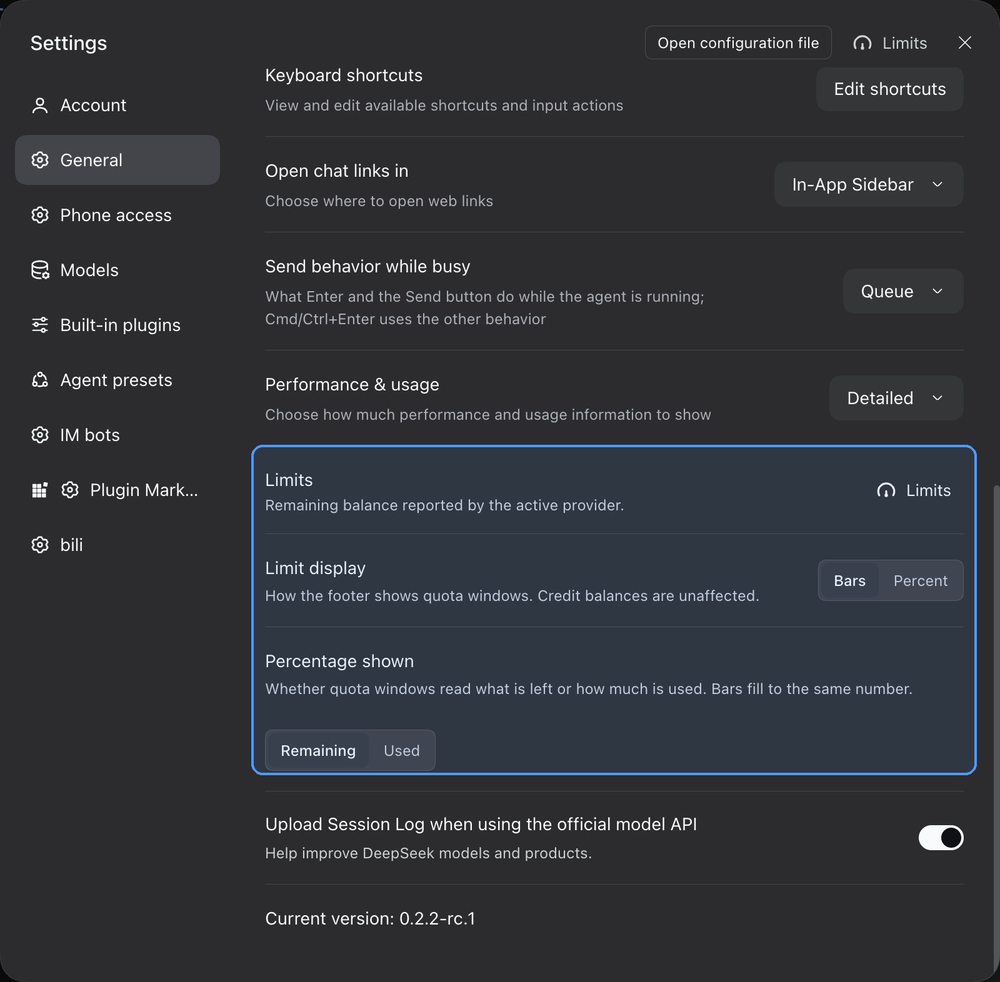
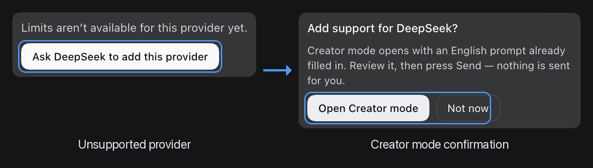

# dsh-provider-limits

[](https://github.com/SavaStone/dsh-provider-limits/actions/workflows/test.yml)
[](LICENSE)

A [DeepSeek Harness](https://github.com/deepseek-ai/deepseek-harness) (DSH) plugin that shows how much of your AI provider's limit is left — right in the app, without opening a dashboard.

It supports **OpenRouter** (credit balance) and **OpenCode Go** (quota windows), detects which provider the chat you are looking at uses, and keeps the numbers up to date by itself.

Version 0.4.0 · MIT · DSH 0.2.2 or newer.



*The same readout in its three display modes: bars with the share left, bars with the share used, and percentages only.*

## What you get

- **A `Limits` button in the sidebar footer**, directly above the `Signed in to …` account row. Click it and the current readout appears right above the button; click again and it goes away.
- **The same readout in the settings panel**: a `Limits` button in the panel header (visible on every section) and a `Limits` row on the **General** page. Both open the same report in place — no page switch and no dialog.
- **A credit balance**, when the provider reports money. For example: `OpenRouter credits are $10`. The amount is bold; the rest of the sentence is normal.
- **Quota windows**, when the provider reports usage limits. For example OpenCode Go shows its three windows — `5 hours`, `Weekly`, `Monthly` — each with the percentage left, a coloured bar and, when the provider gives one, a `resets in 3h 12m` countdown.
- **Colour that tells you when to worry.** The bar is green while there is room, amber once at most 35% is left, and red once at most 15% is left. The percentage text takes the same colour, and the bar length encodes the number independently, so the state is still readable without colour vision.
- **No invented numbers.** A window the provider did not report is shown as `unavailable`, never as `0% left`.
- **The right account.** The readout follows the chat you are looking at: the plugin asks DSH which model that chat uses and reports that provider. Switching models in one chat does not change what an older chat reports. If the provider is unknown, the plugin says so instead of showing another provider's balance.
- **Live figures.** Each readout refreshes every 30 seconds, when you click the button, and when the window regains focus. However many readouts are open, the provider is asked at most once per 20 seconds, and a failure is retried after 5 seconds.
- **A way to request a provider that is not supported yet** — see [Unsupported providers](#unsupported-providers).

## Settings

There are two settings. Both live in **Settings → General**, together with the rest of the app's preferences, and both apply to the whole app, not to one provider. They are saved immediately and survive restarts.



*Both controls live on Settings → General; the plugin's rows are highlighted.*

### Limit display

How quota windows are drawn:

| Choice | What you see |
| --- | --- |
| **Bars** (default) | The percentage plus a short coloured bar. |
| **Percent** | Only the percentage; the bar is hidden. |

Credit balances are not affected: they are a sentence, with no bar to hide. Reset countdowns stay in both modes.

### Percentage shown

What the percentage on a quota row means:

| Choice | What you see |
| --- | --- |
| **Remaining** (default) | `72% left` — the bar is filled to the share still available. |
| **Used** | `28% used` — the bar is filled to the share already spent. |

The green/amber/red colour always follows what is **left**, regardless of this setting: a window that is 90% used is still red, because only 10% is left.

Both settings take effect immediately in every open readout.

## Requirements

- **DSH 0.2.2 or newer.** The footer alignment follows the account row introduced in that version.
- **A provider API key**, available through the DSH credential store or the process environment:

| Provider | Credential name |
| --- | --- |
| OpenRouter | `OPENROUTER_API_KEY` |
| OpenCode Go | `OPENCODE_GO_API_KEY` |

The key is read again on every refresh, so a rotated or newly added key is picked up without restarting DSH. Only a change to the plugin's own code needs a restart.

## Install

The plugin is installed into a DSH profile as a bundle. It is not published on npm, so install it from a checkout or from a packed tarball.

1. Get the code — either clone this repository or download the tarball from the [latest release](https://github.com/SavaStone/dsh-provider-limits/releases):

   ```bash
   git clone https://github.com/SavaStone/dsh-provider-limits
   ```

2. Install it into your profile:

   ```bash
   dsh plugin --profile <profile> add ./dsh-provider-limits
   ```

   With the release tarball, pass the downloaded `.tgz` file instead of the checkout directory.

3. Restart the app. The host half is loaded at startup, so adding the bundle while the app is running is not enough.

To update, pull the new code in your checkout (or download the newer tarball) and restart DSH.

### After installing

Nothing needs to be configured in a profile file: the package carries its own bundle patch, and the install command adds it to the profile's bundle list.

## Usage

Press `Limits` anywhere it appears — the footer, the settings header, or the General row — and the readout opens in place. Press it again to close it.

What the readout looks like depends on the provider:

```
OpenRouter credits are $10
```

```
OpenCode Go
5 hours        72% left
━━━━━━━━━━━━━━━━━━━━━━░
resets in 3h 12m

Weekly         45% left
━━━━━━━━━━━━━━░

Monthly         8% left
━━━░
resets in 6d
```

If no API key is configured, the readout says which variable is missing instead of showing a figure.

## Unsupported providers

If the chat you are looking at uses a provider this plugin does not support yet, the readout says `Limits aren’t available for this provider yet.` and offers one next step: **Ask DeepSeek to add this provider**.

Pressing it asks for confirmation first. The confirmation explains that Creator mode will open with an English prompt already filled in — and that **nothing is sent automatically**: the prompt becomes a draft, and you press Send yourself. The prompt asks the agent to research the provider's balance or quota API, add the provider to the plugin, update the docs and tests, run the tests, and finally ask whether to commit and push the update.

In the web build the prompt opens in a new browser tab. In the desktop app it opens as a new session in the same window. If Creator mode cannot be opened, the prompt is copied to the clipboard instead; if that fails too, the card offers **Try again**.



*Left: the card shown for an unsupported provider. Right: the confirmation before Creator mode opens. The prompt is only drafted — you still press Send yourself.*

## Troubleshooting

The readout names the reason instead of failing silently. What each message means:

| What you see | Why | What to do |
| --- | --- | --- |
| `… has no API key configured (NAME)` | No credential was found for the active provider — neither in the DSH credential store nor in the environment. | Set the named variable for the app process, or add the key to the DSH credential store, then click `Limits` again. No restart is needed. |
| `Limits aren’t available for this provider yet.` | The active provider has no adapter in this build. | Use the **Ask DeepSeek to add this provider** button, or switch to a supported provider. |
| `This account has no OpenCode Go subscription.` | The OpenCode Go key is valid, but the account has no Go plan. | Subscribe to OpenCode Go, or switch to a model from a provider the account does have. |
| `… rejected the request (HTTP 401)`. | The provider refused the key. | Check that the key is valid, not revoked and has the right scope. |
| `Could not reach …`. | No response from the provider: DNS, network, TLS, or the 10-second timeout expired. | Check connectivity from the machine running DSH, and whether the provider's endpoint is reachable from your region. |
| `… returned no readable balance.` | The provider answered, but not in a shape the plugin understands — usually because the provider changed its API. | Inspect the response and update the matching adapter in `index.js` (see [Development](#development)). |

If `Limits` does not appear at all, the host half is probably not mounted: check that the bundle is in the profile and that the app was restarted after adding it.

`Limits` answers with HTTP 200 even when the provider itself failed, because the reason is shown in the page, not as a transport error. Only a wrong HTTP method gets a non-200 status.

## Supported providers and roadmap

| Provider | Credential | Endpoint | Shipped |
| --- | --- | --- | --- |
| OpenRouter | `OPENROUTER_API_KEY` | `https://openrouter.ai/api/v1/credits` | yes |
| OpenCode Go | `OPENCODE_GO_API_KEY` | `https://opencode.ai/console/api/go/status` (falls back to `https://opencode.ai/zen/go/v1/usage`) | yes |
| DeepSeek | `DEEPSEEK_API_KEY` | `https://api.deepseek.com/user/balance` | not yet |
| Moonshot / Kimi | `MOONSHOT_API_KEY` | `https://api.moonshot.ai/v1/users/me/balance` | not yet |
| Zhipu / GLM | `ZAI_API_KEY`, `GLM_API_KEY`, `ZHIPU_API_KEY` | `https://open.bigmodel.cn/api/biz/account/query-customer-account-report` | not yet |
| MiniMax | `MINIMAX_API_KEY` | `https://www.minimax.io/v1/token_plan/remains` | not yet |

The four unshipped providers are declared in the provider table with their endpoints and credential names, but they are turned off until their endpoints have been verified against a live API and their adapters have been written.

### OpenCode Go details

The readout is derived from the exact micro-cent meters behind the Go console, so it agrees with the console's own percentages. If that route is unavailable, the plugin falls back to the public usage endpoint, which reports whole percentages that are **floored** rather than rounded: a spend the console shows as `2%` used can read as `1%` there, and the plugin would show one point more remaining than the console. Neither source reports a dollar amount, so the readout stays in percentages.

## Privacy

- **The API key never reaches the browser.** It is resolved in the DSH host process and sent only to the provider API that owns it, with that provider's own authorization header. It is never relayed through another endpoint or another provider.
- **The page receives numbers only** — the balance, the quota percentages, reset times, the provider id and a timestamp. No key material and no raw upstream response.
- **Other account fields are dropped.** The OpenCode Go status response also contains account and payment identifiers; the plugin reads only the three quota meters, and those identifiers never leave the host.

## Development

The plugin has no runtime dependencies and no build step. Node.js 20 or newer is enough.

```bash
npm test            # or: node test-host.mjs && node test-client.mjs
npm run check       # syntax check of both halves
```

The two suites are dependency-free and run on push and pull requests in CI (Node 20, 22 and 24):

- `test-host.mjs` — the host half: adapter arithmetic, credential resolution, provider detection, upstream failure shapes, the HTTP contract and the read cache.
- `test-client.mjs` — the browser half: it loads `client.js` the way the browser does and checks every slot, state and rendered shape, including the preference rows and the unsupported-provider request.

Layout:

| File | What it is |
| --- | --- |
| `index.js` | Host half: the provider table, the adapters, the two local HTTP routes and the read cache. |
| `client.js` | Browser half: the footer control, the settings-panel controls, the readout and the two preference rows. |
| `cordis.patch.yml` | The bundle patch that mounts the plugin when it is installed. |
| `locale/en.json`, `locale/zh.json` | Names and descriptions for the plugin list. |
| `icon.svg` | The plugin icon. |

### Adding a provider

Two edits in `index.js`:

1. Add (or enable) an entry in the `PROVIDERS` table: `label`, `kind`, `envs` (credential names, tried in order), `urls` (endpoints, tried in order), `auth` (`bearer` or `raw`) and `needsKey`. Set `enabled: true`. If the provider has a more precise source, add `precise: { kind, urls }`; if a `403 EntitlementError` means "valid key, no subscription", add `entitlement: true`.
2. Write the parser in the `ADAPTERS` map, keyed by the same `kind`. It receives the response body and returns either a credit balance — `{ kind: 'balance', balance: { remaining, used, total, currency, symbol } }` — or quota windows — `{ kind: 'windows', windows: [{ id, usedPercent, remainingPercent, resetsAt }] }` — or `undefined` when nothing can be read. Return `undefined` instead of throwing; the host turns that into the "unreadable" message.

The client needs no change: it renders whichever of the two shapes the adapter returns. Add the provider to the tables above, and extend both test suites.

Before enabling a provider, confirm its endpoint, auth form, response shape and units against a live API call — the unshipped rows in `PROVIDERS` are placeholders, not verified endpoints.

## License

[MIT](LICENSE) © SavaStone
